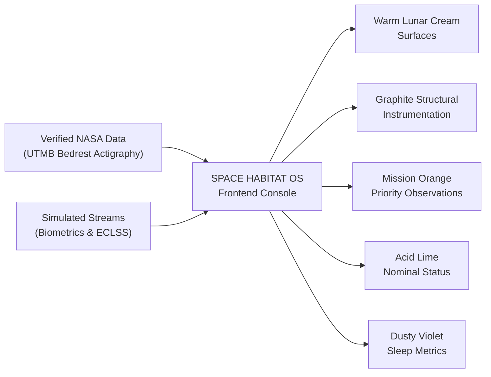
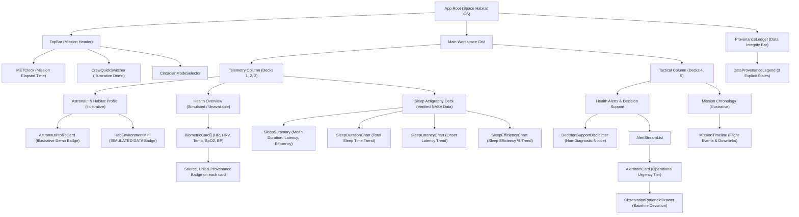
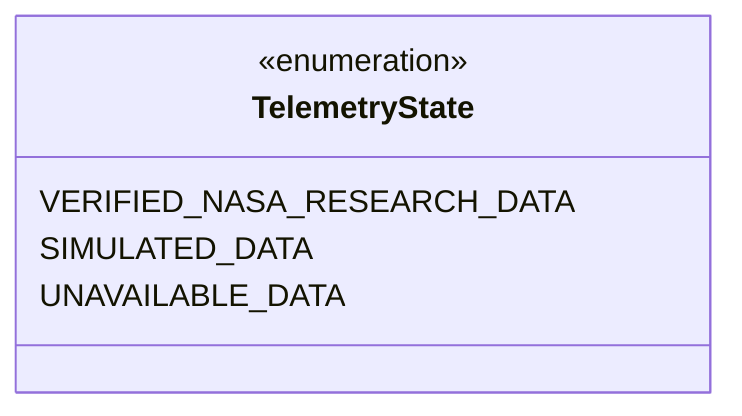

# ORBITAL CARE // SPACE HABITAT OS
## Frontend Architecture & Design Specification
**NASA Space Apps Challenge 2026 — Astronaut Health Decision Support Telemetry**
**Document Version:** 2.0.0-REVISED // **Target Directory:** `frontend/`
**Technology Stack:** Vite + React + TypeScript + Tailwind CSS + Recharts

---

## 1. Executive Summary & Design Direction

### 1.1 Philosophy: Space Habitat OS
The **ORBITAL CARE** frontend departs sharply from generic dark-navy/neon-violet AI dashboards. It is modeled as a mission-critical **Space Habitat Operating System (H-OS)** — an editorial, aerospace-grade clinical telemetry interface engineered for long-duration spaceflight human health monitoring.

The interface balances two operational priorities:
1. **Clinical Rigor & Provenance Transparency:** Telemetry must be transparent, legible, glanceable, and uncorrupted. Every data stream must explicitly disclose its origin, unit, and whether it is verified NASA research, simulated, or unavailable. The system provides decision support and trend observations — not autonomous medical diagnosis.
2. **Habitability & Sensory Ergonomics:** Astronauts living in sterile, enclosed microgravity habitats require calm, warm, human-centered tactile aesthetics that prevent sensory fatigue and minimize cognitive stress.



---

## 2. Visual Theme & Design Tokens

### 2.1 Palette Architecture
The palette avoids synthetic saturated blues and glowing neon purples. Instead, it pairs tactile regolith warm tones with carbon graphite, punctuated by functional aerospace indicators.

| Token Identifier | HEX Value | Role & Usage |
| :--- | :--- | :--- |
| `--surface-ground` | `#F5F2EB` | **Warm Lunar Cream:** Primary viewport background; mimics matte anodized lunar console casing. |
| `--surface-panel` | `#FCFAF6` | **Pale Regolith:** Instrument cards, telemetry containers, white-paper clinical readability. |
| `--surface-elevated` | `#ECE7DC` | **Dusted Sand:** Secondary panels, table headers, elevated instrument bays. |
| `--surface-graphite` | `#16181C` | **Deep Carbon Graphite:** Flight deck instrumentation bars, high-contrast metric callouts, dark mode sub-decks. |
| `--surface-graphite-card`| `#22252C` | **Modular Graphite Card:** For mission clock, alert drawer, and high-contrast telemetry panels. |
| `--text-primary` | `#17181D` | **Carbon Black:** High-acuity metric values, headlines, clinical observation text. |
| `--text-secondary` | `#585E6D` | **Graphite Slate:** Labels, unit measures, secondary status info. |
| `--text-muted` | `#8A91A0` | **Dust Muted:** Timestamps, inactive states, grid lines. |
| `--text-inverse` | `#F7F5F0` | **Lunar White:** Text rendered over dark graphite surfaces. |
| `--color-mission-orange`| `#E65100` | **Mission Ascent Orange:** Operational alerts, active timeline markers, high-priority call-to-actions. |
| `--color-mission-orange-subtle` | `#FFF3EB` | Orange alert background tint for cream surfaces. |
| `--color-acid-lime` | `#689F00` | **Orbital Velocity Lime:** Nominal telemetry, baseline-aligned metrics, verified bio-sync active. |
| `--color-acid-lime-subtle` | `#F1F8E9` | Lime status background tint. |
| `--color-dusty-violet` | `#665584` | **Sleep Violet:** Sleep duration, sleep latency, and sleep efficiency actigraphy indicators. |
| `--color-dusty-violet-subtle` | `#F3EFF9` | Violet metric background tint. |
| `--border-instrument` | `rgba(23, 24, 29, 0.14)` | Fine 1px mechanical hairline card border. |
| `--border-instrument-dark`| `rgba(255, 255, 255, 0.12)` | Hairline for dark graphite modules. |

### 2.2 Circadian Shift Modes (Lighting Accommodations)
- **Daylight Nominal (Default):** Warm Lunar Cream ground with crisp graphite typography and balanced accents.
- **Pre-Sleep / Red-Shift (Toggle):** Low blue-light mode shifting background to deep carbon (`#121316`), warming all whites to soft amber (`#E5A96E`), and suppressing cool wavelengths.

### 2.3 Typography Matrix
A dual-type system separating **tactical instrumentation** from **editorial readability**:

```
+----------------------------------------------------------------------------------+
| DISPLAY / TELEMETRY METRICS                                                      |
| Font: Space Mono / JetBrains Mono / ui-monospace                                 |
| Features: tabular-nums, uppercase, letter-spacing: +0.05em                      |
| Examples: 482 MIN, LATENCY: 24 MIN, EFF: 87.4%, [VERIFIED NASA RESEARCH DATA]   |
+----------------------------------------------------------------------------------+
| EDITORIAL / CLINICAL OBSERVATIONS & NOTES                                        |
| Font: Plus Jakarta Sans / Inter / system-ui                                      |
| Features: tight tracking on titles, generous line-height on observation briefs  |
| Examples: "Sleep latency increased by 14 min relative to individual baseline"    |
+----------------------------------------------------------------------------------+
```

| Type Scale | Size / Line-Height | Font Family | Weight | Purpose |
| :--- | :--- | :--- | :--- | :--- |
| `display-lg` | 36px / 40px | Technical Mono | 700 Bold | Primary MET Clock, Key Metric Highlights |
| `metric-val` | 28px / 32px | Technical Mono | 600 SemiBold| Primary data readouts (Duration, Latency, Efficiency) |
| `title-lg` | 20px / 26px | Instrument Sans | 700 Bold | Section titles, astronaut name, primary alert headline |
| `title-sm` | 14px / 18px | Instrument Sans | 600 SemiBold| Sub-card headers, telemetry group labels |
| `body-reg` | 13px / 20px | Instrument Sans | 400 Regular | Decision support narratives, observation notes |
| `badge-mono` | 11px / 14px | Technical Mono | 600 SemiBold| Data provenance tags, units, module codes |

---

## 3. Page Layout & Navigation Architecture

### 3.1 Spatial Grid & Chrome Structure
The layout uses a permanent **Aerospace Instrument Top Bar** and a modular **Three-Deck Responsive Grid**.

```
+------------------------------------------------------------------------------------+
| TOP BAR: [ORBITAL CARE // H-OS v2.0] | MET 048:14:32:05 | ISS/HAB-03 [ILLUSTRATIVE] |
+------------------------------------------------------------------------------------+
| CREW SELECTOR: [CDR Vance (Demo)] [FE-1 Zhang (Demo)] | MODE: [DAY] | FILTER: [ALL]  |
+--------------------------------------------------+---------------------------------+
| PRIMARY TELEMETRY VIEW (Col 1-8 / 66% width)     | TACTICAL SIDEBAR (Col 9-12 / 34%)|
|                                                  |                                 |
| [1. ASTRONAUT & MISSION STATUS (ILLUSTRATIVE)]   | [4. DECISION SUPPORT ALERTS]    |
| - Demo Profile, Illustrative Mission Sol         | - Observation vs. Baseline      |
| - Cabin ECLSS mini: [SIMULATED DATA]             | - Explainable Trends & Notes    |
|                                                  | - Decision support (non-diag)   |
| [2. HEALTH OVERVIEW (SIMULATED / UNAVAILABLE)]   +---------------------------------+
| - HR, HRV, Temp, SpO2, BP                        | [5. MISSION CHRONOLOGY]         |
| - Explicitly labeled [SIMULATED] or [UNAVAILABLE]| - Illustrative Mission Timeline |
| - Units, source labels, zero unvalidated scores  | - Scheduled Sleep / Rest Windows|
|                                                  | - Telemetry Downlink Milestones |
| [3. SLEEP ACTIGRAPHY (VERIFIED NASA DATA)]       |                                 |
| - UTMB Bedrest Campaign 1 Actigraphy Dataset     |                                 |
| - SleepDurationChart (min / hrs over time)       |                                 |
| - SleepLatencyChart (min to sleep onset)         |                                 |
| - SleepEfficiencyChart (% time asleep in bed)    |                                 |
| - SleepSummary (individual baselines & means)    |                                 |
+--------------------------------------------------+---------------------------------+
| [6. DATA PROVENANCE & INTEGRITY DOCK] (Full Width 12-Col)                          |
| - [VERIFIED NASA RESEARCH DATA] | [SIMULATED DATA] | [UNAVAILABLE DATA]            |
+------------------------------------------------------------------------------------+
```

### 3.2 Navigation Controls
- **Deck Tab Switcher:**
  - `[01 // OVERVIEW]`
  - `[02 // SLEEP ACTIGRAPHY (NASA RESEARCH)]`
  - `[03 // HEALTH OVERVIEW (SIMULATED)]`
  - `[04 // DECISION SUPPORT ALERTS]`
  - `[05 // MISSION TIMELINE]`
- **Global Actions Bar:**
  - Circadian Lighting Shift (Nominal Cream / Red-Shift Night).
  - Provenance Filter (`All Data`, `Verified NASA Only`, `Simulated Only`).

---

## 4. Component Hierarchy



---

## 5. Detailed Specifications for Core Dashboard Sections

### Section 1: Astronaut Profile & Mission Status (Illustrative)
- **Purpose:** Contextualize the human operator in the mission environment.
- **Mandatory Illustrative Labeling:**
  - The astronaut profile (e.g. name, rank, flight assignment) is explicitly tagged with `[ILLUSTRATIVE DEMO PROFILE]`.
  - Mission Elapsed Time (MET) and flight day counts are designated as `[SIMULATED FLIGHT SCHEDULE]`.
- **Habitat Environment Mini-Strip:**
  - Ambient Cabin $CO_2$, Cabin Pressure, and Ambient Temperature must be prominently marked with the `[SIMULATED DATA]` badge unless directly bound to a verified hardware downlink.
  - Required fields on every readout: Metric Name, Value, Unit of Measure (e.g. $\text{mmHg}$, $\text{psi}$, $^\circ\text{C}$), Data Source (`SIM-ECLSS-01`), and Provenance Badge.

### Section 2: Health Overview (Simulated / Unavailable Telemetry)
- **Purpose:** Displays general biometric parameters while maintaining strict data integrity.
- **Strict Data Constraints:**
  - **Zero Unverified Claims:** Heart Rate (HR), Heart Rate Variability (HRV), Core Body Temperature, Oxygen Saturation ($SpO_2$), and Blood Pressure (BP) **must NOT** be presented as real NASA measurements.
  - When displayed for demonstration, each biometric card **must be explicitly labeled `[SIMULATED DATA]`**.
  - When no telemetry stream is connected, the card must render **`[UNAVAILABLE DATA]`** with value `---`.
  - **Removal of Unvalidated Scores:**
    - The composite "Vitality Index" (CVI) is **removed**. No arbitrary scoring formulas are permitted.
    - Cohort baseline delta comparisons (e.g., comparing against an invented "NASA flight mean") are **removed**.
- **Per-Card Metric Contract:**
  Each biometric card renders:
  1. Parameter Name (e.g., *Resting Heart Rate*)
  2. Measured / Simulated Value with Unit (e.g., `64 bpm`, `98.2%`, `120/80 mmHg`)
  3. Source Identifier (e.g., `SOURCE: SYNTHETIC VITAL ENGINE v1.2` or `SOURCE: NONE`)
  4. Explicit Provenance Badge: `[SIMULATED DATA]` or `[UNAVAILABLE DATA]`.

### Section 3: Sleep & Recovery Trends (Verified NASA Research Data)
- **Data Source:** **UTMB Bedrest Campaign 1 Actigraphy Dataset** (NASA Human Research Program).
- **Scope & Boundaries:**
  - The UTMB dataset measures actigraphy-derived sleep metrics:
    1. **Sleep Duration:** Total elapsed sleep time in minutes and decimal hours per sleep episode.
    2. **Sleep Latency:** Time elapsed between retiring to bed and actual sleep onset in minutes.
    3. **Sleep Efficiency:** Ratio of total sleep time to total time spent in bed, expressed as a percentage:
       $$\text{Sleep Efficiency} = \left(\frac{\text{Sleep Duration}}{\text{Time in Bed}}\right) \times 100\%$$
  - **Explicit Exclusions:**
    - Four-stage sleep hypnograms (Wake, REM, Light, Deep/SWS) are **removed** because actigraphy does not provide electroencephalographic (EEG) sleep staging.
    - Unvalidated "Recovery Gauges" and arbitrary "Sleep Debt Scores" are **removed**.
- **Component Architecture:**
  - `SleepSummary.tsx`: Displays key aggregate statistics from the actigraphy records (e.g. subject mean duration, mean latency, mean efficiency, campaign day count).
  - `SleepDurationChart.tsx`: Time-series bar/line chart tracking daily sleep duration across bedrest days against the subject's baseline average.
  - `SleepLatencyChart.tsx`: Time-series line chart tracking latency minutes to onset, highlighting extended latency periods.
  - `SleepEfficiencyChart.tsx`: Time-series area chart showing sleep efficiency percentage with a clinical reference threshold line (e.g., $\ge 85\%$ nominal efficiency).

### Section 4: Health Alerts & Explainable Decision Support
- **Purpose:** Decision support for human operators and crew medical officers based on transparent metric observations.
- **Mandatory Regulatory & Diagnostic Disclaimers:**
  - **"DECISION SUPPORT ONLY — NOT A CLINICAL OR MEDICAL DIAGNOSIS."**
  - **No unverified standard claims:** The specification does not claim formal NASA alert classification or NASA-STD-3001 certification without official testing and verification.
- **Alert Generation Rationale:**
  - Alerts are formulated as **explainable observations** derived from real or connected data (e.g., changes in sleep duration, latency, and efficiency relative to an individual's historical baseline).
  - *Example Alert 1 (Advisory):* "Sleep latency increased to 48 min (baseline: 19 min, +152% deviation) over consecutive bedrest days 12–14."
  - *Example Alert 2 (Caution):* "Sleep efficiency dropped to 72.1% (baseline: 88.4%, -16.3% deviation) across the last 48-hour observation window."
- **Observation Card Elements:**
  - Urgency Tier: `Advisory` (Informational deviation), `Caution` (Significant baseline deviation).
  - Observed Metric & Magnitude of change relative to individual historical baseline.
  - Associated Timeframe / Study Day.
  - Transparent Rationale (exact mathematical delta, no black-box diagnosis).
  - Potential Operational Suggestions (e.g., review sleep hygiene protocol, inspect ambient noise/light levels).

### Section 5: Integrated Mission Timeline (Illustrative Chronology)
- **Purpose:** Correlate observation timestamps with operational activity contexts.
- **Designation:** Clearly labeled as `[ILLUSTRATIVE MISSION TIMELINE]`.
- **Visual Elements:**
  - Chronological scrubber showing historical observation epochs and planned rest periods.
  - Downlink / sync acquisition status indicators.

### Section 6: Data-Source Provenance & Integrity Deck
- **Purpose:** Provide complete transparency on the origin, credibility, and fidelity of all presented data.
- **Full-Width Provenance Ledger:** Always visible or accessible, detailing every connected data source.

---

## 6. Sleep Analysis Charting Specifications

All sleep visualizations are built using **Recharts** and strictly represent verified actigraphy parameters from the NASA UTMB Bedrest dataset.

```
SLEEP DURATION CHART (UTMB BEDREST ACTIGRAPHY)
DURATION (HRS)
  8 |     [■]       [■]   [■]             [■]   <- Individual Baseline (7.4 hrs)
  6 | [■] [■]   [■] [■]   [■] [■]     [■] [■]
  4 | [■] [■]   [■] [■]   [■] [■] [■] [■] [■]
  0 +-----------------------------------------
      D1  D2    D3  D4    D5  D6  D7  D8  D9 (Bedrest Study Day)
      PROVENANCE: [VERIFIED NASA RESEARCH DATA // UTMB CAMPAIGN 1]
```

### 6.1 Component Specifications
1. **`SleepDurationChart.tsx`:**
   - **Type:** Recharts `BarChart` with a reference line.
   - **X-Axis:** Bedrest Study Day (Day 1, Day 2, ..., Day N).
   - **Y-Axis:** Total Sleep Duration (decimal hours or minutes, e.g. 0 to 10 hrs).
   - **Datum:** Subject's pre-bedrest baseline duration rendered as a dashed horizontal reference line (`stroke="#665584"`).
   - **Bar Styling:** Fill `--color-dusty-violet` (`#665584`), radius `[3, 3, 0, 0]`.
   - **Card Footer:** Explicit badge: `[VERIFIED NASA RESEARCH DATA — UTMB BEDREST CAMPAIGN 1]`.

2. **`SleepLatencyChart.tsx`:**
   - **Type:** Recharts `LineChart` or `AreaChart`.
   - **X-Axis:** Bedrest Study Day.
   - **Y-Axis:** Sleep Onset Latency (minutes).
   - **Datum:** Nominal latency upper threshold reference line ($\le 30\text{ min}$).
   - **Curve Styling:** Crisp 2px line in Mission Orange (`#E65100`) or Graphite Slate, with dots on observation points. Highlights spikes where onset took abnormally long.

3. **`SleepEfficiencyChart.tsx`:**
   - **Type:** Recharts `AreaChart`.
   - **X-Axis:** Bedrest Study Day.
   - **Y-Axis:** Sleep Efficiency Percentage ($0 - 100\%$).
   - **Reference Band:** Normal clinical efficiency reference zone ($\ge 85\%$) shaded in subtle acid lime tint (`rgba(104, 159, 0, 0.08)`).
   - **Line Styling:** Solid line in Orbital Velocity Lime (`#689F00`).

4. **`SleepSummary.tsx`:**
   - **Type:** 4-card metric overview strip:
     1. *Mean Sleep Duration* (e.g., `7.1 hrs` | `Unit: Hours` | `[VERIFIED NASA RESEARCH]`)
     2. *Mean Sleep Latency* (e.g., `22.4 min` | `Unit: Minutes` | `[VERIFIED NASA RESEARCH]`)
     3. *Mean Sleep Efficiency* (e.g., `86.2%` | `Unit: Percent` | `[VERIFIED NASA RESEARCH]`)
     4. *Total Recorded Epochs / Days* (e.g., `30 Days` | `Campaign: UTMB Bedrest 1`)

---

## 7. Data-Source Distinction: The Three Explicit States

Every measurement, graph, and metric card across the interface must strictly belong to one of three explicit provenance states:



```
+-----------------------------------------------------------------------------------------+
| STATE 1: [VERIFIED NASA RESEARCH DATA]                                                  |
| Badge: [● VERIFIED NASA RESEARCH DATA]                                                  |
| Badge Style: Solid dark graphite background, crisp acid lime indicator dot              |
| Card Surface: Crisp Pale Regolith (#FCFAF6)                                             |
| Border: Solid 1px Mechanical Hairline (rgba(23, 24, 29, 0.16))                          |
| Required Metadata: Exact Dataset Citation (e.g., "NASA HRP UTMB Bedrest Campaign 1")   |
| Numerals: 100% Opacity Carbon Black (#17181D) with explicit unit label                  |
+-----------------------------------------------------------------------------------------+
| STATE 2: [SIMULATED DATA]                                                               |
| Badge: [⟐ SIMULATED DATA]                                                               |
| Badge Style: Monospace amber/graphite font, dashed perimeter border                     |
| Card Surface: Warm cream with subtle mechanical hatch pattern watermark                 |
| Border: Dashed 1.5px border (stroke-dasharray: 4, 3)                                    |
| Required Metadata: Simulation Model ID (e.g., "SIM-MODEL: CARDIO-SYNTH-v1")             |
| Graph Curves: Rendered with dashed strokes to instantly communicate synthetic data      |
+-----------------------------------------------------------------------------------------+
| STATE 3: [UNAVAILABLE DATA]                                                             |
| Badge: [✕ UNAVAILABLE DATA]                                                             |
| Badge Style: Muted slate tag with diagonal slash icon                                   |
| Card Surface: Muted translucent overlay (opacity: 0.50), disabled instrument appearance |
| Border: Dotted 1px border                                                               |
| Value Readout: Strictly "---" (Zero fabricated numbers)                                 |
| Context Note: "No verified telemetry source connected. Measurement unavailable."       |
+-----------------------------------------------------------------------------------------+
```

### 7.1 Provenance Contract
Every data display component must accept a typed contract requiring:
```typescript
interface TelemetryMetric<T> {
  name: string;
  value: T | null;
  unit: string;
  source: string;
  provenance: 'VERIFIED_NASA_RESEARCH_DATA' | 'SIMULATED_DATA' | 'UNAVAILABLE_DATA';
  timestamp?: string;
  baselineComparison?: {
    baselineValue: number;
    deltaPercentage: number;
  };
}
```

---

## 8. Responsive Layout Strategy

The Space Habitat OS interface is optimized across three screen configurations:

```
1. FLIGHT DECK WORKSTATION (>= 1440px)
+--------------------------------------------------------------------------+
| TOP BAR (MET Clock + Illustrative Crew Selector + Provenance Indicator)  |
+----------------------------------------------------+---------------------+
| PRIMARY VIEWPORT (66% Width)                       | TACTICAL SIDEBAR    |
| - Section 1: Astronaut Profile & Status (Demo)     | (34% Width)         |
| - Section 2: Health Overview (Simulated/Unavail)   | - Section 4: Alerts |
| - Section 3: Sleep Actigraphy Deck                 |   & Decision Support|
|   (UTMB Bedrest NASA Research Data)                | - Section 5: MET    |
|   (Duration, Latency, Efficiency, Summary)         |   Chronology (Demo) |
+----------------------------------------------------+---------------------+
| Section 6: Global Data Provenance Dock (Full Width 12-Col)               |
+--------------------------------------------------------------------------+

2. HABITAT CREW TABLET / LAPTOP (1024px - 1439px)
+--------------------------------------------------------------------------+
| TOP BAR (Compact MET + Active Subject)                                   |
+--------------------------------------------------------------------------+
| 2-Column Responsive Layout:                                              |
| Column 1 (55%): Section 1 Profile (Demo) + Section 2 Health Overview     |
| Column 2 (45%): Section 4 Decision Support Alerts & Section 5 Timeline   |
+--------------------------------------------------------------------------+
| Full-width Section 3: Sleep Actigraphy Analysis Deck (Verified NASA Data)|
+--------------------------------------------------------------------------+

3. CREW HANDHELD / MOBILE MONITOR (< 1024px / 390px)
+--------------------------------------------------------------------------+
| DOCKED MISSION HEADER (MET Ticker + Provenance Filter)                   |
+--------------------------------------------------------------------------+
| SINGLE-COLUMN VERTICAL FEED (Order of Priority):                         |
| 1. Decision Support Alerts (Explainable baseline deviations)             |
| 2. Sleep Actigraphy Summary (Duration, Latency, Efficiency)              |
| 3. Health Overview Cards (Labeled SIMULATED or UNAVAILABLE)              |
| 4. Illustrative Timeline & Provenance Ledger                             |
+--------------------------------------------------------------------------+
| BOTTOM DOCKED INSTRUMENT NAV                                             |
+--------------------------------------------------------------------------+
```

---

## 9. Frontend Architecture (Within `frontend/`)

**Technology Stack:**
- **Framework & Bundler:** Vite + React (TypeScript)
- **Styling:** Tailwind CSS + CSS custom properties (design tokens)
- **Charting Engine:** Recharts (SVG-based, accessible, fully customizable with custom tokens)
- **Icons:** Lucide React (aerospace & instrument iconography)

```
frontend/
├── docs/
│   └── DESIGN_SPECIFICATION.md           # This approved specification
├── src/
│   ├── assets/                           # Aerospace insignia, technical patterns
│   ├── components/
│   │   ├── common/                       # Atomic UI primitives
│   │   │   ├── Badge.tsx                 # 3 Provenance Badges (NASA vs Sim vs Unavail)
│   │   │   ├── Card.tsx                  # Instrument card with hairline borders
│   │   │   ├── MetricValue.tsx           # Tabular mono formatted values with unit
│   │   │   └── StatusIndicator.tsx       # Nominal lime, caution amber, alert orange
│   │   ├── navigation/
│   │   │   ├── TopBar.tsx                # Aerospace top chrome with MET clock
│   │   │   └── DeckSwitcher.tsx          # Deck/section switching navigation
│   │   ├── profile/
│   │   │   ├── AstronautProfileCard.tsx  # Section 1: Illustrative Demo Profile
│   │   │   └── HabEnvironmentMini.tsx    # Section 1: Simulated ECLSS strip
│   │   ├── vitals/
│   │   │   └── BiometricCard.tsx         # Section 2: HR, HRV, Temp, SpO2, BP (SIM/UNAVAIL)
│   │   ├── sleep/
│   │   │   ├── SleepSummary.tsx          # Section 3: Mean duration, latency, efficiency
│   │   │   ├── SleepDurationChart.tsx    # Section 3: Actigraphy total duration
│   │   │   ├── SleepLatencyChart.tsx     # Section 3: Actigraphy onset latency
│   │   │   └── SleepEfficiencyChart.tsx  # Section 3: Actigraphy efficiency percentage
│   │   ├── alerts/
│   │   │   ├── AlertsFeed.tsx            # Section 4: Filterable alert stream
│   │   │   ├── AlertCard.tsx             # Section 4: Urgency-coded alert item
│   │   │   ├── ObservationRationaleDrawer.tsx # Section 4: Explainable baseline deviation
│   │   │   └── DecisionSupportDisclaimer.tsx  # Section 4: Non-diagnostic notice
│   │   ├── timeline/
│   │   │   ├── MissionTimeline.tsx       # Section 5: Illustrative chronology scrubber
│   │   │   └── TimelineEventNode.tsx     # Section 5: Event node
│   │   └── provenance/
│   │       ├── ProvenanceLedger.tsx      # Section 6: Data source transparency dock
│   │       └── SourceInspectorModal.tsx  # Section 6: Audit trail inspector
│   ├── styles/
│   │   ├── tokens.css                    # CSS variables for Space Habitat OS
│   │   └── globals.css                   # Core typography & reset
│   └── types/
│       ├── astronaut.ts                  # Illustrative crew & habitat interfaces
│       ├── vitals.ts                     # Biometric readings & provenance metadata
│       ├── sleep.ts                      # UTMB actigraphy data structures
│       └── alerts.ts                     # Urgency levels, observation deltas
├── tailwind.config.ts                    # Customized with Space Habitat OS tokens
├── tsconfig.json
└── package.json
```

---

## 10. Design Checklist & Accuracy Sign-off

| Design & Scope Criteria | Status in Specification | Rigorous Verification Notes |
| :--- | :---: | :--- |
| **Aesthetic: Space Habitat OS** | Maintained | Warm Lunar Cream, Graphite, Mission Orange, Acid Lime, Dusty Violet. No generic navy/purple glow. |
| **Sleep Dataset Scope** | Corrected | Grounded strictly in verified **UTMB Bedrest Campaign 1 Actigraphy** (Duration, Latency, Efficiency). |
| **Sleep Components** | Corrected | `SleepDurationChart.tsx`, `SleepLatencyChart.tsx`, `SleepEfficiencyChart.tsx`, `SleepSummary.tsx`. |
| **Unsupported Sleep Staging Removed** | Corrected | 4-stage hypnograms, REM/Deep/Light/Wake percentages completely removed. |
| **Health Overview Integrity** | Corrected | HR, HRV, Temp, SpO2, BP never presented as real NASA data. Explicitly `SIMULATED` or `UNAVAILABLE`. |
| **Unvalidated Scores Removed** | Corrected | Vitality Index, Recovery Gauge, Sleep Debt Score, and NASA cohort baselines removed. |
| **Alerts & Decision Support** | Corrected | Explainable observations based on baseline deviations. Explicit non-diagnostic disclaimer. No unverified NASA standard claims. |
| **Mission & Environmental Details** | Corrected | Profiles and flight schedule labeled `[ILLUSTRATIVE DEMO]`. ECLSS cabin strip labeled `[SIMULATED DATA]`. |
| **Three Provenance States** | Enforced | `VERIFIED NASA RESEARCH DATA`, `SIMULATED DATA`, `UNAVAILABLE DATA`. Unit, source, and label on every metric. |
| **Technology Stack** | Confirmed | Vite + React + TypeScript + Tailwind CSS + Recharts. |
| **Constraint Adherence** | 100% | Documentation only. 0 packages installed, 0 code generated, 0 backend changes, 0 branch switches. |
